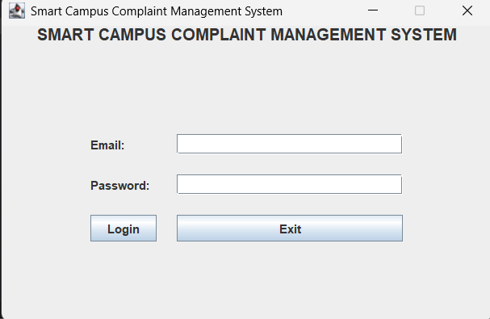
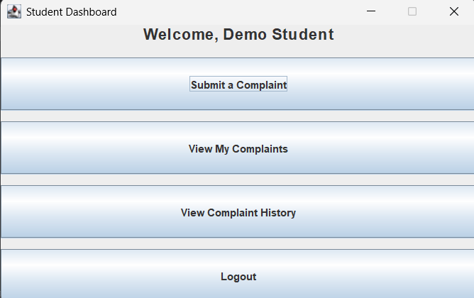
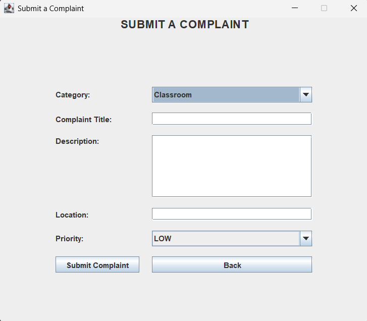
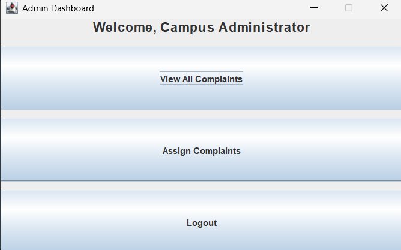
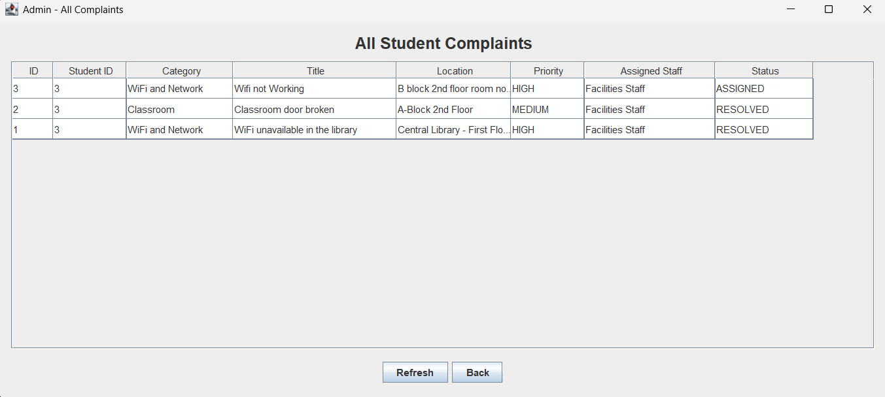
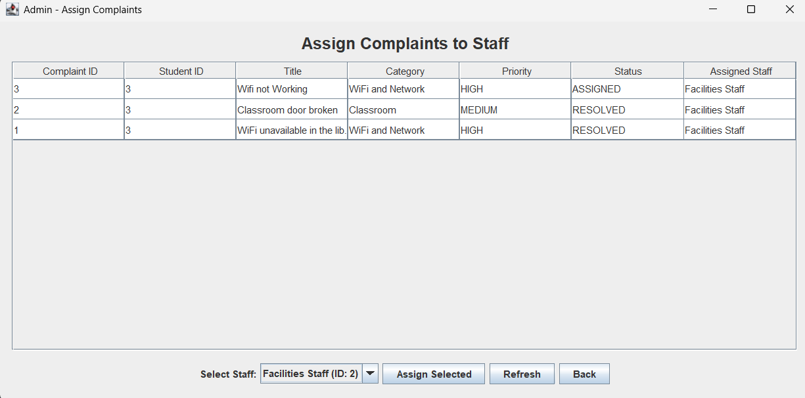
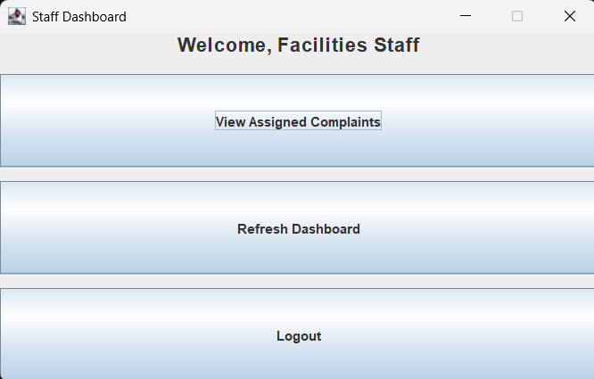
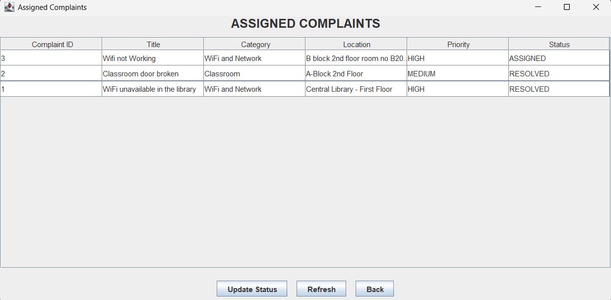

# Smart Campus Complaint Management System

A Java-based campus complaint management application developed as an Object-Oriented Programming mini-project. The system enables students to submit campus complaints, administrators to manage and assign complaints to staff, and staff members to track and update complaint progress.

## Features

### Authentication and User Management

* **Role-based authentication:** Separate login access for students, staff, and administrators.
* **Role-specific dashboards:** Different interfaces and functionality for each user role.

### Student Features

* **Complaint submission:** Submit complaints related to campus facilities and services.
* **Complaint categorization:** Organize complaints by category and priority.
* **My Complaints:** View submitted complaints, their current statuses, and assigned staff.
* **Complaint history:** View recorded updates associated with submitted complaints.

### Staff Features

* **Assigned complaints:** View complaints assigned to the logged-in staff member.
* **Status management:** Update complaint statuses as work progresses.
* **Update messages:** Provide explanations or comments when changing a complaint's status.
* **Complaint history tracking:** Record status changes and associated messages in the database.

### Administrator Features

* **Admin dashboard:** Access administrative complaint-management functions.
* **View all complaints:** View complaints submitted by students, including their categories, priorities, assigned staff, and statuses.
* **Staff assignment:** Assign complaints to available staff members.
* **Assignment status:** Update the complaint's assignment and status in the database.
* **Complaint monitoring:** Review complaint details and track their progress.

### Technical Features

* **MySQL integration:** Store and retrieve application data using JDBC.
* **Java Swing interface:** Provide graphical interfaces for students, staff, and administrators.
* **Console interface:** Includes a console application entry point.
* **Report generation:** Includes report-generation functionality using Java threading, as described in the original project.

## Complaint Workflow

The application supports the following complaint-management workflow:

1. A student logs in and submits a complaint.
2. The complaint is stored in the MySQL database with its category, priority, description, and location.
3. The administrator views all submitted complaints.
4. The administrator assigns a complaint to an appropriate staff member.
5. The assigned staff member views the complaint in their dashboard.
6. Staff members update the complaint status as work progresses.
7. Status changes and update messages are recorded in the complaint history.
8. Students and administrators can review complaint information and its current status through their respective interfaces.

**Typical status progression:**

`SUBMITTED → ASSIGNED → IN_PROGRESS → RESOLVED`

The actual status progression depends on the actions performed within the application.

## Tech Stack

| Technology     | Purpose                                 |
| -------------- | --------------------------------------- |
| Java 21        | Application development                 |
| MySQL          | Relational database management          |
| JDBC           | Database connectivity                   |
| Java Swing     | Graphical user interface                |
| Eclipse IDE    | Development environment                 |
| Git and GitHub | Version control and source-code hosting |

## Project Structure

```text
SmartCampusComplaintManagement/
├── src/
│   └── com/smartcampus/cms/
│       ├── dao/          # Database access objects
│       ├── exception/    # Custom exceptions
│       ├── model/        # Application models
│       ├── service/      # Business logic and authentication
│       ├── ui/           # Console and Swing interfaces
│       ├── util/         # Database connection and utilities
│       ├── Main.java     # Console application entry point
│       └── GuiMain.java  # Swing application entry point
├── sql/
│   └── smart_campus_cms_schema.sql
├── docs/
│   └── screenshot/       # Project screenshots, if present
├── .gitignore
├── .classpath
├── .project
└── README.md
```

*The directory structure above summarizes the main project components. Individual files may vary depending on the current implementation.*

## Prerequisites

Before running the application, install:

* Java Development Kit (JDK) 21
* MySQL Server
* MySQL Connector/J
* Eclipse IDE or another compatible Java IDE
* Git, if you intend to clone or contribute to the repository

## Installation and Setup

### 1. Clone the Repository

```bash
git clone https://github.com/prajwalkhatavakar25/smart-campus-complaint-management.git
```

Import the downloaded project into Eclipse as an existing Java project.

### 2. Create the Database

Open MySQL Workbench or your preferred MySQL client.

Execute the SQL script:

```text
sql/smart_campus_cms_schema.sql
```

The script creates the `smart_campus_cms` database, the required tables, and the default complaint categories.

### 3. Configure the Database Connection

The current application configuration uses:

| Setting  | Value                     |
| -------- | ------------------------- |
| Host     | `localhost`               |
| Port     | `3307`                    |
| Database | `smart_campus_cms`        |
| Username | Your local MySQL username |
| Password | Your local MySQL password |

If your MySQL server uses a different port, update the JDBC URL in `DBConnection.java`.

The database password is read from the `DB_Password` environment variable.

On Windows PowerShell, set this variable for the current terminal session:

```powershell
$env:DB_Password = "YOUR_LOCAL_MYSQL_PASSWORD"
```

Replace the placeholder with your own MySQL password.

Never commit your actual database password to GitHub.

If you launch Eclipse separately, ensure Eclipse inherits the environment variable or configure it in the application's run configuration.

### 4. Configure MySQL Connector/J

Add the MySQL Connector/J JAR to your Eclipse project's Java Build Path.

1. Right-click the project.
2. Select **Build Path → Configure Build Path**.
3. Open the **Libraries** tab.
4. Select **Add External JARs**.
5. Choose your MySQL Connector/J JAR.
6. Apply the changes.

### 5. Run the Application

After configuring the database and JDBC driver, run one of these classes:

* `com.smartcampus.cms.Main` — Console application.
* `com.smartcampus.cms.GuiMain` — Java Swing application.

Database-dependent features require a running MySQL server and correctly configured database credentials.

## Application Screenshots

### Login Screen



### Student Dashboard



### Complaint Submission Form



### Admin Dashboard



### All Student Complaints



### Assign Complaints to Staff



### Staff Dashboard



### Staff Complaint Management




Use demonstration data in screenshots. Do not publish real passwords, private complaint descriptions, or personal information.

## Database Design

The application uses MySQL tables to store user accounts, complaint categories, complaints, and complaint updates.

The main entities include:

* **Users:** Stores user details, roles, and department information.
* **Categories:** Stores complaint categories.
* **Complaints:** Stores complaint descriptions, locations, priorities, statuses, and staff assignments.
* **Complaint updates:** Records complaint status changes and their associated messages.

The `assigned_staff_id` field associates a complaint with a staff member. Complaint-update records are associated with the relevant complaint and the user who made the update.

## Security Considerations

* Keep database passwords and other credentials out of source code.
* Configure database credentials locally rather than committing them to GitHub.
* Do not upload generated reports containing personal or confidential information.
* Use demonstration or anonymized data when showcasing the application.
* Restrict access to administrative functionality through appropriate authentication and authorization.
* Use secure password-storage practices for user accounts.

## Future Enhancements

* Improve authentication and password security.
* Add automated unit and integration tests.
* Add complaint filtering by status, priority, category, and assigned staff.
* Introduce administrator dashboard statistics.
* Record administrator staff assignments in the complaint history.
* Enhance complaint reporting and export capabilities.
* Improve database configuration portability.
* Improve the graphical interface and usability.
* Add validation and error handling across all user interfaces.

---

Developed as a Java Object-Oriented Programming mini-project.
